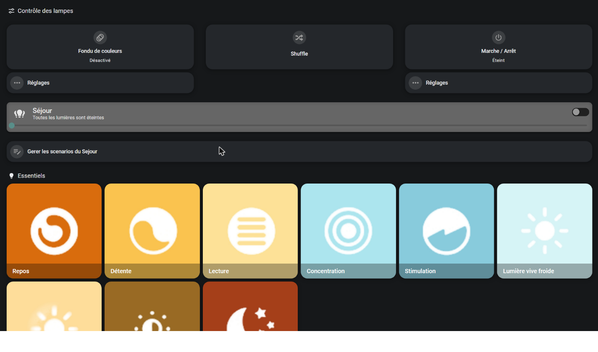
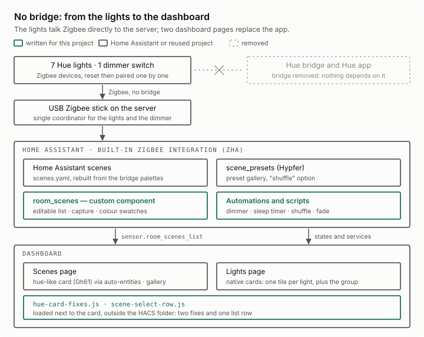

# Lumières et scènes : se passer de l'application Hue

*Une page Home Assistant qui remplace l'application Philips Hue au quotidien : scènes, galerie d'ambiances, liste éditable depuis l'écran, variateur mural. Sans pont, sans compte, sans Internet.*

**En bref.** Le pont Philips Hue a été retiré. Les sept lampes Hue sont maintenant reliées directement au serveur, et deux pages du tableau de bord domotique remplacent l'application Hue au quotidien : régler chaque lampe, choisir une ambiance dans une galerie de plus de 130, créer ses propres scènes depuis l'écran, se servir de l'interrupteur mural, programmer l'extinction. Tout reste local : ni pont, ni compte, ni Internet. Cette page explique comment, ce qu'il a fallu écrire en plus des projets existants, et ce qui n'a pas été possible.

## Ce que faisait l'application, ce qui la remplace

| Dans l'application Hue | Ici | Qui le fournit |
|---|---|---|
| Allumer une lampe ou toutes, régler luminosité et teinte | page **Lumières** : une tuile par lampe, et une pour le groupe des sept | cartes natives de Home Assistant |
| La galerie de scènes | page **Scènes** : 137 ambiances en 20 catégories ; un appui long mélange leurs couleurs entre les lampes | intégration `scene_presets` |
| Ses propres scènes, et en enregistrer une nouvelle | la carte « Séjour » façon application Hue, et un panneau pour ajouter, capturer l'état des lampes, renommer, déplacer, retirer | carte `hue-like-light-card` et composant maison `sejour_scenes` |
| Les scènes dynamiques | **Fondu** : les couleurs de l'ambiance tournent entre les lampes ; **Shuffle** : un seul mélange | scripts maison |
| Le variateur mural | ses quatre boutons, traduits en automatisations | automatisations maison |
| La minuterie d'extinction | **Extinction planifiée**, de 1 à 120 minutes | automatisation et script maison |

Seule fonction perdue : la synchronisation avec l'écran (Hue Sync).

## Les décisions

| Question | Décision | Pourquoi |
|---|---|---|
| Garder le pont ? | non, il est retiré | tout ce que j'en utilisais est refait en local |
| Zigbee2MQTT ou l'intégration Zigbee incluse dans Home Assistant ? | l'intégration incluse (ZHA) | la clé Zigbee du serveur tournait déjà avec elle : une brique de moins à installer et à surveiller |
| Lampes et capteurs sur la même clé ? | oui, sous surveillance | une panne de la clé couperait les deux. Toutes les 10 minutes, une tâche compte les lampes joignables : branchées sur le secteur, elles sont toujours en ligne. Si les sept tombent ensemble alors que la clé est présente, la tâche relance Home Assistant, au plus une fois par demi-heure |
| Rendre la liste des scènes éditable : modifier la carte, ou écrire à côté ? | un petit composant à part | une carte modifiée est écrasée à sa prochaine mise à jour |
| Où corriger les défauts de la carte ? | dans un module posé à côté d'elle | même raison |

## Sans pont : du Zigbee direct

Les lampes Hue sont des appareils Zigbee standard. Le serveur avait déjà une clé Zigbee USB, pilotée par l'intégration Zigbee incluse dans Home Assistant (ZHA), pour des capteurs. En juillet 2026, chaque lampe a été réinitialisée puis appairée directement sur cette clé, puis le variateur mural. Le groupe des sept lampes est un simple groupe de lumières de Home Assistant.

Ce que la migration a appris :

- **Exporter les scènes avant de toucher à la première lampe.** Quand une lampe quitte le pont, le pont efface sa part de chaque scène ; il ne reste qu'un résumé, la palette de couleurs de la scène. Les 41 scènes personnelles ont été reconstruites à partir de ces palettes ; quatre, dont la palette était inutilisable, ont été refaites à la main.
- **Retirer une lampe de l'application ne la réinitialise pas** : elle garde son ancien réseau et n'en rejoint pas d'autre. Ce qui a marché : tenir le variateur Hue tout près de la lampe et appuyer une dizaine de secondes sur ses boutons haut et bas ensemble. La lampe clignote : elle est remise à zéro.
- **La portée d'abord.** Une lampe remise à zéro ne rejoignait pas la clé depuis sa place. Appairée à une trentaine de centimètres de la clé, puis remise en place, elle a rejoint le réseau en une quinzaine de secondes. Une fois appairée, une lampe branchée sur le secteur relaie aussi le réseau Zigbee.
- **Le variateur demande une étape de plus.** Il se réinitialise en retirant sa pile une trentaine de secondes. Une fois appairé, aucun appui ne remontait : il a fallu lancer « Reconfigurer » dans ZHA pour établir les liaisons de ses boutons. Après plusieurs redémarrages de Home Assistant, ces liaisons ont dû être refaites : depuis, une modification d'automatisation se recharge, sans redémarrer.
- **Deux pièges des scènes de Home Assistant.** Dans `scenes.yaml`, `brightness_pct` est ignoré sans erreur, et il fait converger les lampes d'une scène multicolore vers une seule couleur : il faut `brightness` (de 0 à 255). Et l'`id:` d'une scène la lie au registre des entités : le changer laisse un fantôme qui garde le nom, et la scène renaît avec un suffixe `_2`. Un `id:` choisi ne bouge plus.

## Les deux pages

**Lumières** : le réglage à la main. Une grande tuile pour le groupe, puis une tuile par lampe, rangées par emplacement, chacune avec sa luminosité et sa température de blanc ; un appui sur l'icône ouvre la roue des couleurs. Rien que des cartes natives.

**Scènes** : les ambiances. De haut en bas :

1. **le contrôle des lampes** : Fondu et ses réglages, Shuffle, marche/arrêt et extinction planifiée ;
2. **la carte « Séjour »** (`hue-like-light-card`), qui reproduit l'écran de scènes de l'application Hue, avec les 35 scènes de ma liste ;
3. **le panneau « Gérer les scénarios »** : ajouter une scène existante, capturer l'état actuel des lampes, déplacer ou renommer, retirer (avec confirmation) ;
4. **la galerie** : 137 ambiances de `scene_presets`, en 20 catégories. Un appui applique l'ambiance aux sept lampes ; un appui long l'applique en mélangeant ses couleurs.

**Shuffle et Fondu** agissent sur la dernière ambiance appliquée, qu'elle vienne de la galerie ou de ma liste : une automatisation la retient à chaque choix fait à l'écran, et arrête le fondu en cours. Un capteur tient la palette de chaque ambiance (241 palettes : 141 ambiances de la galerie, 100 scènes). L'intervalle du fondu (3 à 60 s) et la durée de chaque transition (0,5 à 10 s) se règlent à l'écran. Le fondu est une boucle de script avec une attente réglable : le déclencheur à intervalle fixe d'une automatisation ne sait pas lire un réglage. Shuffle garde la luminosité choisie à la main.

**L'extinction planifiée** se règle de 1 à 120 minutes (0 = désactivée). Au redémarrage de Home Assistant, le réglage revient à 0, et seul un geste à l'écran lance le compte à rebours : une minuterie ne se réarme jamais seule.

Les scripts de Shuffle, du Fondu et de l'extinction ne sont pas dans cette pièce.

## Ce qui n'a pas été possible

**Les images officielles des scènes.** Dans l'application Hue, les scènes de la galerie sont illustrées par des photos. Le pont ne les sert pas (ses deux API ont été interrogées), et l'application les télécharge depuis un service de Signify. Ces images appartiennent à Signify : aucune ne figure dans ce dépôt. Une scène créée depuis l'écran reçoit une pastille de couleur calculée d'après ses lampes.

## Ce qui vient d'ailleurs

| Projet | Licence | Ce que j'en utilise |
|---|---|---|
| [Hypfer/hass-scene_presets](https://github.com/Hypfer/hass-scene_presets) | Apache-2.0 | les ambiances de la galerie et leurs vignettes, le service `scene_presets.apply_preset` et son option `shuffle` |
| [Gh61/lovelace-hue-like-light-card](https://github.com/Gh61/lovelace-hue-like-light-card) | LGPL-2.1 | la carte façon application Hue |
| [thomasloven/lovelace-auto-entities](https://github.com/thomasloven/lovelace-auto-entities) | MIT | remplir la carte avec la liste publiée par `sejour_scenes` |
| [Home Assistant](https://github.com/home-assistant/core) | Apache-2.0 | ZHA, groupes de lumières, scènes, cartes natives |

Leur code n'est pas republié ici. Ce que j'y ajoute : le composant `sejour_scenes`, deux modules posés à côté de la carte, les automatisations du variateur, les scripts Shuffle et Fondu, et les deux pages. Réalisé avec un agent IA (Claude Code) : je fixe les objectifs, je décide, je teste sur les lampes et je valide ; l'agent écrit et exécute le code.

## `sejour_scenes` : la liste des scènes, éditable depuis l'écran

**Le besoin.** La carte `hue-like-light-card` affiche les scènes qu'on lui donne dans le YAML du tableau de bord : ajouter, renommer ou réordonner une scène voulait dire éditer ce fichier. Je voulais le faire depuis l'écran, comme dans l'application. La liste vit donc dans un petit composant Home Assistant à part, d'environ 420 lignes de Python, qu'aucune mise à jour n'écrase.

**Le principe.**

- Le composant garde la liste dans un fichier JSON et la publie dans l'attribut `list` du capteur `sensor.sejour_scenes_list`, au format que la carte attend (`entity`, `title`, `icon`, `color`).
- `auto-entities` place cette liste dans le paramètre `scenes` de la carte : une modification s'affiche en une seconde environ, sans recharger la page.
- Le composant publie aussi un attribut `rows` : les lignes toutes faites de la liste de gestion.

| Service | Ce qu'il fait |
|---|---|
| `sejour_scenes.add` | ajoute une scène existante, à la fin ou à une position donnée |
| `sejour_scenes.remove` | la retire de la liste (la scène elle-même reste) |
| `sejour_scenes.rename` | change le titre affiché |
| `sejour_scenes.move` | la déplace (0 = tout en haut) |
| `sejour_scenes.capture` | crée une scène à partir de l'état exact des lampes (allumée ou non, couleur, luminosité), l'ajoute à la fin de `scenes.yaml` sans réécrire le reste du fichier, recharge les scènes et l'ajoute à la liste |

**La pastille de couleur.** Une scène ajoutée ou capturée reçoit une couleur calculée d'après ses lampes : la teinte dominante des lampes allumées (celle qui pèse le plus, en nombre de lampes et en luminosité), à pleine saturation. Le mélange des couleurs a été essayé et écarté : il délave les scènes multicolores jusqu'au presque blanc. Pour une scène d'une seule couleur, une icône ronde colorée faisait apparaître un rond blanc au milieu de la pastille (la carte peint l'icône en blanc) : le composant génère donc une image unie de 400 × 400 pixels et la rattache à la scène par un fichier de configuration qu'il écrit lui-même, sans toucher à `configuration.yaml`. Une image faite à la main n'est jamais écrasée. Au démarrage, les pastilles incomplètes sont rattrapées.

**Le piège qui a coûté trois redémarrages.** Le composant reconstruit ses attributs à partir d'une liste qu'il modifie sur place. Home Assistant comparait l'ancien et le nouvel état, les trouvait égaux (ce sont les mêmes objets) et ignorait la mise à jour : aucune erreur, aucun journal, l'écran ne bougeait pas. `force_update=True` règle le problème ; le commentaire du code demande de ne pas le retirer.

**Une ligne de liste qui choisit au lieu d'allumer.** Dans le panneau « Déplacer / renommer », appuyer sur une ligne doit choisir la scène à modifier, pas l'allumer. La ligne de scène native de Home Assistant allume toujours (son bouton ignore l'action configurée), et la ligne « bouton » perd l'image de la scène. [`www/scene-choix-row.js`](www/scene-choix-row.js) reprend la ligne native, image et bouton compris, et change seulement ce que fait le bouton : il exécute l'action de la ligne, qui sélectionne la scène dans la liste déroulante.

**Les limites.** Les chemins sont ceux du conteneur de Home Assistant (`/config/...`). Pour éviter un nom déjà pris, la capture cherche `- id: scene_<nom>` dans `scenes.yaml` : un fichier écrit dans un autre style peut lui échapper. La liste est rangée dans le dossier du composant : recopier ce dossier par-dessus la remplace. La ligne de liste s'appuie sur deux éléments internes de Home Assistant, qui ne sont pas une interface publique et peuvent changer à une mise à jour.

**Pour le réutiliser.**

1. Copier [`custom_components/sejour_scenes/`](custom_components/sejour_scenes/) dans le dossier de configuration, et ajouter la ligne `sejour_scenes:` à `configuration.yaml`. Dans `sejour_scenes.json`, `lights` liste les lampes ; le groupe y figure mais n'est jamais capturé (son nom est la constante `GROUPE_ENTITY`).
2. Activer les paquets (`packages: !include_dir_named packages` sous `homeassistant:`) : le composant y écrit le rattachement des images unies.
3. Copier [`exemples/paquet-liste-des-scenes.yaml`](exemples/paquet-liste-des-scenes.yaml) dans `packages/` : le groupe des lampes, les deux listes déroulantes et l'automatisation qui tient leurs options à jour.
4. Installer `hue-like-light-card` et `auto-entities`, copier `www/scene-choix-row.js` à la racine de `www/` (pas dans `www/community/`) et le déclarer comme ressource du tableau de bord (type module).
5. Partir de [`exemples/vue-scenes.yaml`](exemples/vue-scenes.yaml), puis redémarrer Home Assistant.

Dépendances : Pillow et PyYAML, déjà présents dans Home Assistant. Les cinq services s'appellent depuis Outils de développement → Actions, ou depuis un script. Sur mon tableau de bord, les boutons du panneau de gestion appellent six petits scripts qui lisent la liste déroulante ; ils ne sont pas dans cette pièce.

## Corriger une carte sans toucher à son dossier

La carte `hue-like-light-card` avait deux défauts.

1. **Sur téléphone, les lampes tombaient en bas de l'écran.** Sous 450 px de large, la carte place la rangée des lampes à 30 px du bas de sa fenêtre, avec une classe qu'elle pose en permanence. Or, à cette largeur, Home Assistant ouvre ses fenêtres en plein écran : la rangée se retrouvait collée au bas de l'écran, loin de son titre. Mesuré sur ordinateur en forçant la règle : l'écart entre les scènes et les lampes passe de 17 px à −167 px, et revient à 17 px avec le correctif.
2. **Une erreur à la fermeture.** Fermer la fenêtre de la carte par le bouton retour levait une `TypeError` (deux occurrences au journal) : la carte appelait `close()` sur un élément pas encore prêt. Aucune version publiée de la carte ne corrigeait ce défaut quand il a été traité.

**La leçon : un correctif ne s'écrit pas dans le dossier d'une extension HACS.** HACS remplace ce dossier à chaque mise à jour ou réinstallation, et le correctif disparaît sans bruit. Le second correctif avait d'abord été écrit dans le fichier de la carte ; six jours plus tard, il a été réécrit à côté d'elle. Les deux vivent désormais dans [`www/hue-correctifs.js`](www/hue-correctifs.js), à la racine de `www/`, où HACS ne va pas. Ce module ne modifie pas le fichier de la carte : il la corrige au chargement de la page. Sur mon installation, la première version est restée dans le fichier de la carte ; les deux ne se gênent pas, et le module prendra le relais quand ce fichier sera remplacé.

**Comment.**

- Le correctif de mise en page est ajouté à la feuille de style de la carte (pour les fenêtres à venir), posé dans `firstUpdated` (filet), et appliqué aux fenêtres déjà ouvertes.
- `close()` n'est pas réécrit mais **enveloppé** : la méthode d'origine est appelée, et le repli que l'auteur avait prévu (`onDialogClose()`) ne sert que si elle échoue. Si une version future de la carte fait davantage dans `close()`, c'est conservé.
- Piège : modifier `connectedCallback` après `customElements.define()` n'a aucun effet, car le navigateur lit les fonctions de cycle de vie une seule fois, à l'enregistrement de l'élément. `close()` et `firstUpdated()` sont appelés par la carte et par Lit : là, ça marche.
- Contrôle : dans la console du navigateur, `window.__correctifHue` liste les accroches posées. Retour arrière : retirer la ressource.

Pour le réutiliser : copier `www/hue-correctifs.js` à la racine de `www/` et le déclarer comme ressource du tableau de bord (type module).

## Le variateur mural

Le variateur Hue à quatre boutons est appairé à ZHA comme les lampes. Il n'a pas d'entité « bouton » : chaque appui arrive comme un événement `zha_event`, avec un nom de commande (`on_short_release`, `off_long_release`, `step`…). Trois automatisations les traduisent. La correspondance a été choisie pour l'usage, pas recopiée de l'ancienne configuration du pont.

| Bouton | Appui court | Appui long |
|---|---|---|
| Haut | cycle de 3 blancs chauds : 2000 K à 50 %, 2000 K à 100 %, 2500 K à 100 % | tout éteindre |
| Bas | cycle de 3 blancs froids : 6500 K à 50 %, 6500 K à 100 %, 4000 K à 100 % | réservé |
| + / − | luminosité ±12 %, lampe par lampe | réservé |

**Un appui ne doit jamais être perdu.** Le cycle se décide sur l'état réel des lampes, pas sur un simple compteur : le compteur restait à 0 après une extinction par un autre moyen ou un redémarrage, et le premier appui passait directement à 100 %. Les règles : lampes éteintes, 1re étape ; plus de 30 minutes sans appui, 1re étape, sauf si les lampes y sont déjà, alors 2e étape ; appuis enchaînés en moins de 10 secondes, étape suivante. Passer d'un bouton à l'autre remet l'autre cycle au départ.

**Un piège de Home Assistant.** Redonner à une entité la valeur qu'elle a déjà ne met pas à jour son heure de modification (`last_updated`). Un minuteur calculé sur le compteur restait donc figé, et le cycle se bloquait sur sa première étape. L'heure du dernier appui est gardée dans une aide à part (`input_datetime`), écrite à chaque appui.

**L'appui long** est reconnu au relâchement : c'est le variateur qui décide qu'un appui est « long ». Une extinction au bout de trois secondes d'appui a été essayée, puis abandonnée : le premier message d'un appui long n'arrivait pas toujours.

Fichier : [`exemples/paquet-variateur.yaml`](exemples/paquet-variateur.yaml), les aides et les trois automatisations ; l'adresse Zigbee du variateur est à remplacer.

## Licence

MIT (voir `LICENSE`). Les projets réutilisés gardent leur propre licence (tableau plus haut) ; leur code n'est pas recopié ici.
