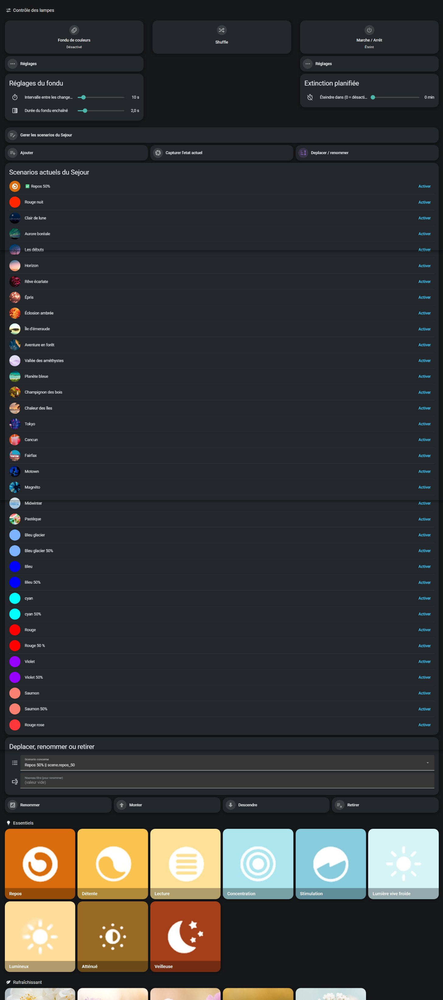
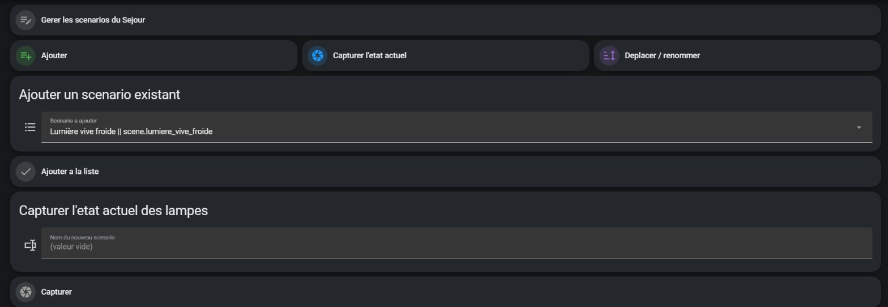
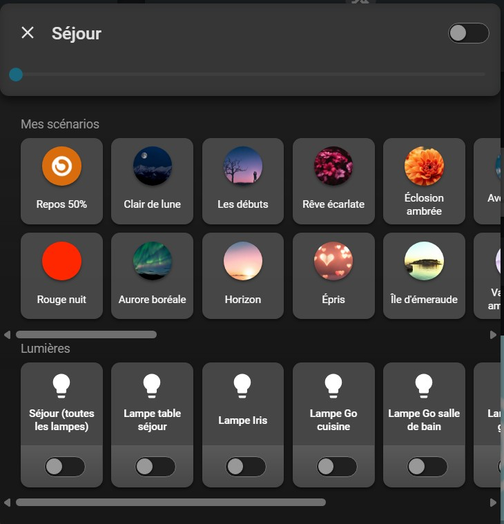
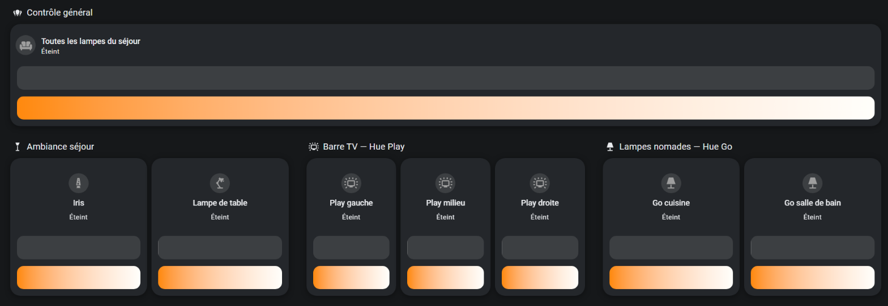
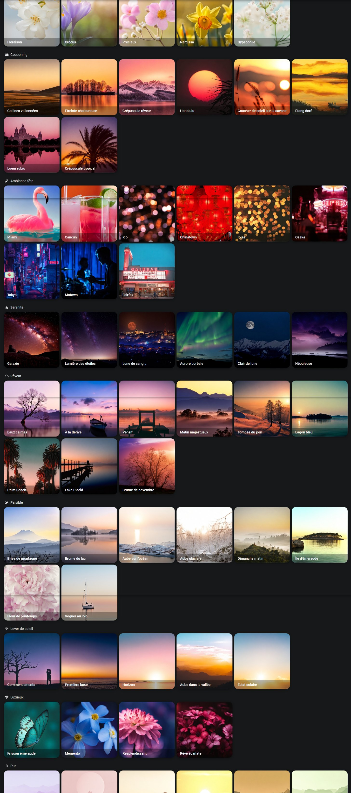
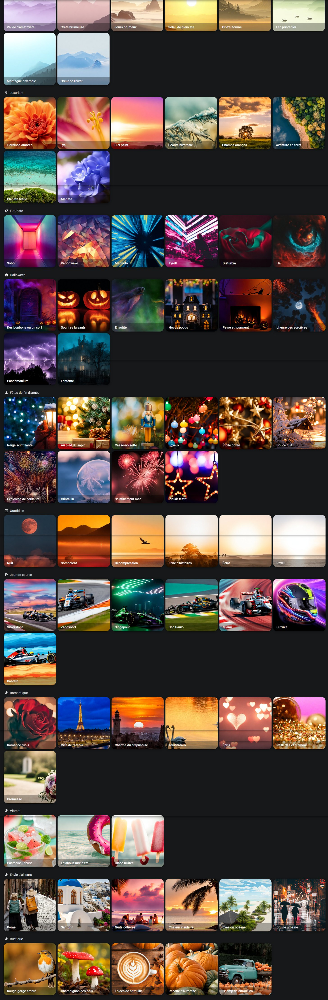

# Hue scenes in Home Assistant, without the Hue bridge

Two Home Assistant pages that replace the Philips Hue app: per-light control, a 137-preset gallery, an editable scene list with on-screen capture, Shuffle/Fade effects, sleep timer and the Hue dimmer switch. Zigbee direct (ZHA): no bridge, no account, no cloud.

## Features

| Hue app | Here | Provided by |
|---|---|---|
| Lights on/off, brightness, colour | **Lights** page: one tile per light + the group | native HA cards |
| Scene gallery | 137 presets in 20 categories; hold = colours shuffled across lights | `scene_presets` |
| Own scenes, save current state | Hue-app-style room card + panel to add, capture, rename, move, remove | `hue-like-light-card` + **`room_scenes`** (this repo) |
| Dynamic scenes | **Fade** (colours rotate, interval 3–60 s, transition 0.5–10 s) and **Shuffle** | scripts (this repo) |
| Dimmer switch | 4 buttons mapped to automations | automations (this repo) |
| Sleep timer | 1–120 min | script + automation (this repo) |

Not replaced: Hue Sync (screen sync).

## Requirements

- Home Assistant with ZHA and a Zigbee coordinator; Hue lights and dimmer reset and paired directly
- HACS: [hue-like-light-card](https://github.com/Gh61/lovelace-hue-like-light-card), [auto-entities](https://github.com/thomasloven/lovelace-auto-entities), [scene_presets](https://github.com/Hypfer/hass-scene_presets)
- Pillow and PyYAML (bundled with Home Assistant)

## Installation

1. Copy [`custom_components/room_scenes/`](custom_components/room_scenes/) to your config folder and add `room_scenes:` to `configuration.yaml`. In `room_scenes.json`, `lights` lists your lights; the group is listed but never captured (constant `GROUP_ENTITY`).
2. Enable packages (`packages: !include_dir_named packages` under `homeassistant:`): the component writes its solid-tile attachments there.
3. Copy to `packages/`: [`scene-list-package.yaml`](examples/scene-list-package.yaml) (light group, dropdowns, sync automation), [`management-package.yaml`](examples/management-package.yaml) (panel scripts), [`effects-package.yaml`](examples/effects-package.yaml) (Shuffle, Fade, sleep timer), optionally [`dimmer-package.yaml`](examples/dimmer-package.yaml).
4. Copy [`www/scene-select-row.js`](www/scene-select-row.js) and [`www/hue-card-fixes.js`](www/hue-card-fixes.js) to the **root** of `www/` (not `www/community/`) and register both as dashboard resources (JavaScript module).
5. Start from [`examples/scenes-view.yaml`](examples/scenes-view.yaml), then restart Home Assistant.

## `room_scenes` component

The card only displays the scenes written in the dashboard YAML. `room_scenes` (~420 lines of Python) keeps the list in a JSON file and publishes it as the `list` attribute of `sensor.room_scenes_list`, in the card's format (`entity`, `title`, `icon`, `color`); auto-entities injects it into the card's `scenes` parameter. Changes show up in about a second, without a page reload. A `rows` attribute provides ready-made rows for the management list.

| Service | Action |
|---|---|
| `room_scenes.add` | add an existing scene, at the end or at a position |
| `room_scenes.remove` | remove it from the list (the scene itself is kept) |
| `room_scenes.rename` | change the displayed title |
| `room_scenes.move` | move it (0 = top) |
| `room_scenes.capture` | create a scene from the exact current light states (on/off, xy colour, brightness), append it to `scenes.yaml` without rewriting the rest of the file, reload scenes, add it to the list |

**Swatch colour.** An added or captured scene gets the dominant hue of its lights that are on (weighted by number of lights × brightness), at full saturation. Additive mixing was rejected: it washes multicolour scenes out to near white. For a single-colour scene, an icon with a colour shows a white dot (the card paints icons white), so the component generates a 400 × 400 solid image and attaches it via a package file it writes itself. Hand-made images are never overwritten; incomplete swatches are fixed at startup.

**`force_update=True` is required.** The component rebuilds its attributes from a list it mutates in place; Home Assistant compared old and new state, found them equal (same objects) and silently dropped the update.

**Select row.** In the move/rename panel, tapping a row must select the scene, not activate it. The native scene row always activates (its button ignores the configured action), and the `button` row loses the scene picture. [`scene-select-row.js`](www/scene-select-row.js) rebuilds the native row (picture + button) and only changes what the button does.

**Limitations.** Paths are those of the HA container (`/config/...`). Capture checks `- id: scene_<name>` in `scenes.yaml` to avoid duplicates; a file written in another style may slip through. The list is stored in the component folder: copying the folder over replaces it. The select row relies on two HA internals (`hui-generic-entity-row`, `ha-button`), not a public API.

## Card fixes outside the HACS folder

`hue-like-light-card` had two bugs:

1. **Phone layout**: below 450 px the card positions the lights row 30 px from the bottom of its dialog, through a class it sets permanently; at that width HA opens dialogs fullscreen, so the row sticks to the bottom of the screen. Measured with the rule forced on desktop: scenes→lights gap 17 px → −167 px, back to 17 px with the fix.
2. **`TypeError` on close**: closing the dialog with browser back called `close()` on a not-yet-upgraded element.

HACS replaces `www/community/` on every update, so a fix written there disappears silently. [`hue-card-fixes.js`](www/hue-card-fixes.js) lives at the root of `www/` and patches the card at load time: CSS added to the card's stylesheet and in `firstUpdated`, and `close()` **wrapped** (original first, author's `onDialogClose()` fallback only on failure). Patching `connectedCallback` after `customElements.define()` has no effect (lifecycle callbacks are read once at registration). Check: `window.__hueCardFixes` in the console. Rollback: remove the resource.

## Shuffle, Fade, sleep timer

- The last scene or preset applied **from the UI** is stored (`input_text.last_applied_scene`); applying a scene also stops Fade.
- `sensor.scene_palettes` holds the xy palette of each scene and preset (241 on my instance).
- Fade is a script loop with an adjustable delay: an automation's time-pattern trigger cannot read a helper. Shuffle keeps the brightness set by hand.
- Sleep timer: the slider counts down; after a restart it is back to 0 and only a user action starts it.

## Dimmer switch

The Hue dimmer (RWL022) has no button entity under ZHA: presses arrive as `zha_event` (`on_short_release`, `off_long_release`, `step`…).

| Button | Short press | Long press |
|---|---|---|
| Up | 3 warm whites: 2000 K 50 %, 2000 K 100 %, 2500 K 100 % | all off |
| Down | 3 cool whites: 6500 K 50 %, 6500 K 100 %, 4000 K 100 % | reserved |
| + / − | brightness ±12 %, light by light | reserved |

The cycle is decided on the **actual** light state, not a counter (a counter stayed at 0 after the lights were turned off another way). Lights off → step 1; > 30 min since last press → step 1 (step 2 if already there); presses within 10 s → next step. The last-press time is a separate `input_datetime`: setting an entity to its current value does not update `last_updated`. Long press is detected on release (the dimmer classifies it).

## Migration notes (bridge → ZHA)

- **Export scenes before unpairing the first light.** When a light leaves the bridge, the bridge deletes its part of every scene; only the scene palette remains. 41 scenes were rebuilt from palettes, 4 by hand.
- **Removing a light in the app does not reset it.** Reset that worked: dimmer held close to the light, Up + Down pressed ~10 s until the light blinks.
- **Pair close to the coordinator** (~30 cm), then move the light back; mains-powered lights then act as routers.
- **Dimmer**: reset by removing the battery ~30 s; after pairing, run *Reconfigure* in ZHA to create the button bindings.
- **Scenes in `scenes.yaml`**: `brightness_pct` is silently ignored and makes multicolour scenes converge to one colour: use `brightness` (0–255). A scene `id:` binds it to the entity registry: changing it leaves a ghost and the scene comes back with a `_2` suffix.
- **Hue app scene images** belong to Signify and are not served by the bridge (both APIs checked): none in this repo.

## Screenshots

| | |
|---|---|
|  |  |
|  |  |
|  |  |

Full scene list: [SCENES.md](SCENES.md). The UI in the screenshots is French.

## Thumbnails

[`thumbnails/scene_presets/`](thumbnails/scene_presets/): the gallery images of scene_presets (Hypfer, Apache-2.0), part of them re-rendered at higher quality; see [`NOTICE.md`](thumbnails/scene_presets/NOTICE.md). [`thumbnails/solid-tiles/`](thumbnails/solid-tiles/): solid tiles generated by `room_scenes`. Attaching them: [`examples/scene-thumbnails.yaml`](examples/scene-thumbnails.yaml). Images added inside the scene_presets integration folder are overwritten by HACS updates.

## Credits

| Project | License | Used for |
|---|---|---|
| [Hypfer/hass-scene_presets](https://github.com/Hypfer/hass-scene_presets) | Apache-2.0 | gallery presets and images, `scene_presets.apply_preset` and its `shuffle` option |
| [Gh61/lovelace-hue-like-light-card](https://github.com/Gh61/lovelace-hue-like-light-card) | LGPL-2.1 | Hue-app-style card |
| [thomasloven/lovelace-auto-entities](https://github.com/thomasloven/lovelace-auto-entities) | MIT | feeding the card from `room_scenes` |
| [Home Assistant](https://github.com/home-assistant/core) | Apache-2.0 | ZHA, light groups, scenes, native cards |

Their code is not redistributed here. Built with Claude Code: I define the requirements, make the design decisions and validate on the hardware; the agent writes and runs the code.

## License

MIT, see [`LICENSE`](LICENSE). Images in `thumbnails/scene_presets/` remain under Apache-2.0 ([`LICENSE`](thumbnails/scene_presets/LICENSE)).
